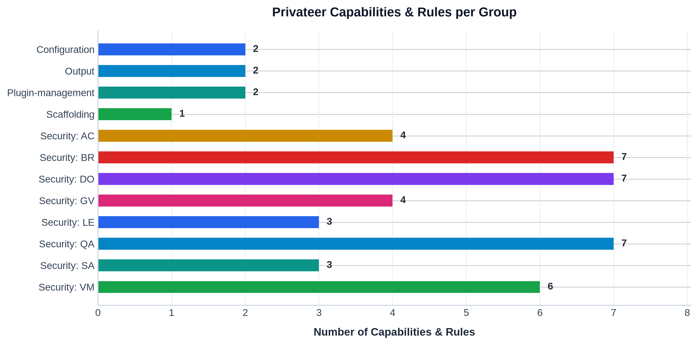

# cncf-checks

OSCAL Component Definition built from [Privateer (pvtr) ](https://github.com/privateerproj/pvtr) validation check definitions mapped to CNCF and NIST SP 800-53 controls.

Output: [trestle.ws/component-definitions/privateer/component-definition.json](trestle.ws/component-definitions/privateer/component-definition.json)

## Overview

`cncf-checks` establishes the formal mapping from [CNCF TAG Security and Compliance ](https://github.com/cncf/contribute-site/tree/main/docs/community/tags/security-and-compliance/publications/controls-catalog) / NIST SP 800-53 Rev. 5 controls to automated [Privateer (pvtr) ](https://github.com/privateerproj/pvtr) checks.

Within the CNCF OSCAL compliance ecosystem:
- **`cncf-controls`**: Provides the master OSCAL Catalog and Profiles built from the CNCF controls catalog.
- **`cncf-checks`** (this repo): Ingests raw Privateer PVP check definitions and derives the OSCAL Component Definition containing both the **`software`** (platform implementation rules) and **`validation`** (Privateer PVP check runners) components directly into `trestle.ws/`.
- **`cncf-compliance`**: Ingests the Component Definitions and Catalogs to formulate project-specific System Security Plans (SSPs), execute automated assessments, and generate compliance reports.

## Component Definition Overview

The Component Definition is derived directly from the downloaded Privateer check manifests, linking NIST SP 800-53 and CNCF CNSC controls to platform rules and Privateer verification checks.

<!-- chart-start -->



<!-- chart-end -->

<!-- table-start -->

| Group / Family | Controls / Targets | Rules | Privateer Checks / Capabilities | Mapped IDs |
|---|:---:|:---:|:---:|---|
| Configuration | 1 | 2 | 2 | PrivProj.CLI.CP01, PrivProj.CLI.CP02 |
| Output | 1 | 2 | 2 | PrivProj.CLI.CP06, PrivProj.CLI.CP07 |
| Plugin-management | 1 | 2 | 2 | PrivProj.CLI.CP03, PrivProj.CLI.CP04 |
| Scaffolding | 1 | 1 | 1 | PrivProj.CLI.CP05 |
| Security: AC | 4 | 4 | 4 | OSPS-AC-01, OSPS-AC-02, OSPS-AC-03, OSPS-AC-04 |
| Security: BR | 7 | 7 | 7 | OSPS-BR-01, OSPS-BR-02, OSPS-BR-03, OSPS-BR-04, OSPS-BR-05, OSPS-BR-06, OSPS-BR-07 |
| Security: DO | 7 | 7 | 7 | OSPS-DO-01, OSPS-DO-02, OSPS-DO-03, OSPS-DO-04, OSPS-DO-05, OSPS-DO-06, OSPS-DO-07 |
| Security: GV | 4 | 4 | 4 | OSPS-GV-01, OSPS-GV-02, OSPS-GV-03, OSPS-GV-04 |
| Security: LE | 3 | 3 | 3 | OSPS-LE-01, OSPS-LE-02, OSPS-LE-03 |
| Security: QA | 7 | 7 | 7 | OSPS-QA-01, OSPS-QA-02, OSPS-QA-03, OSPS-QA-04, OSPS-QA-05, OSPS-QA-06, OSPS-QA-07 |
| Security: SA | 3 | 3 | 3 | OSPS-SA-01, OSPS-SA-02, OSPS-SA-03 |
| Security: VM | 6 | 6 | 6 | OSPS-VM-01, OSPS-VM-02, OSPS-VM-03, OSPS-VM-04, OSPS-VM-05, OSPS-VM-06 |
| **Total** | **45** | **48** | **48** | |

<!-- table-end -->

## Usage

```bash
# Run all steps end-to-end
make all
```

Or step by step:

```bash
make download-privateer-data   # download raw check manifests into download/
make trestle-init              # initialize trestle workspace
make build-compdef             # build OSCAL component definition from downloaded check data
make validate-compdef          # validate component definition with trestle
make update-readme             # regenerate chart and table in README.md
```

Output: [trestle.ws/component-definitions/privateer/component-definition.json](trestle.ws/component-definitions/privateer/component-definition.json)

### All targets

```
make help
```

## Requirements

- Python 3.x
- `compliance-trestle >= 5.2.0` (installed via `make venv`)
- `matplotlib >= 3.8.0` (installed via `make venv`)
